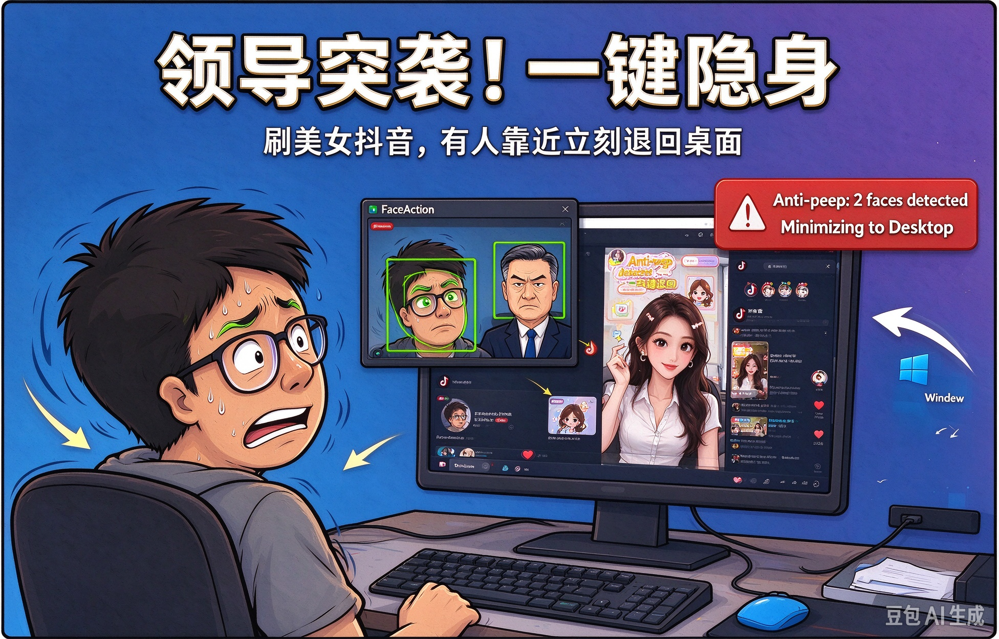

# FaceAction — 面部动作控制助手（刷抖音 + 防偷窥）

对着普通摄像头动动脸，就能刷抖音：**点头切下一条、抬头切上一条、摇头切换菜单**；开启「防偷窥」后，人离开画面自动切到桌面、人回来自动恢复浏览器。全程**本地离线运行，摄像头画面不上传**。

## 项目背景

本项目的出发点很简单：

- **懒人**：躺着/瘫着不想伸手，只想动动脸就能刷短视频；
- **摸鱼族**：上班/上课偷偷刷视频，需要有人靠近时自动隐藏画面；
- **内容创作者**：拍「面部控电脑」段子、直播演示"不用手"的骚操作。

它们的共同诉求是：**看着屏幕、动动脸，就能刷抖音，且能一键防偷窥。** 于是有了 FaceAction —— 一款基于普通摄像头的 Windows 桌面应用，无需任何额外硬件。


*摇头翻页刷视频，有人靠近自动进入防偷窥待机*

## 用户场景

| 群体 | 典型场景 | 核心关注点 |
|------|----------|------------|
| 懒人 | 躺床/瘫沙发刷视频 | 简单、误触低 |
| 摸鱼族 | 上班/上课偷刷，有人靠近秒切桌面 | 防偷窥可靠 |
| 顽梗玩家/创作者 | 录屏/直播演示"无手控电脑" | 演示效果、话题性 |

## 功能特性

### 1. 看抖音

- **进入**：菜单高亮「看抖音」时点头，自动打开系统默认浏览器进入抖音网页版；
- **下一条**：点头（低头）→ 键盘 `↓`；
- **上一条**：抬头（仰头）→ 键盘 `↑`；
- **返回**：连续张嘴两次，回到菜单选择态。

### 2. 防偷窥

- **开关**：菜单高亮「防偷窥」时点头切换开/关；
- **开启后全局生效**：与是否处于看抖音模式无关，两者可并存；
- **脸离开画面**：自动触发 `Win+D` 切到桌面，藏起正在刷的视频；
- **脸回到画面**：自动恢复浏览器；若浏览器尚未启动则自动打开抖音；
- **防抖**：人脸出现/消失状态需持续 500ms 才确认切换，避免画面闪动。


*检测到第二张人脸，立即最小化到桌面*

### 动作 → 指令一览

| 状态 | 动作 | 效果 |
|------|------|------|
| 选择态 | 左摇 / 右摇 | 切换上一项 / 下一项 |
| 选择态 | 点头 | 进入「看抖音」或切换「防偷窥」开关 |
| 看抖音态 | 点头 / 抬头 | 下一条（↓）/ 上一条（↑） |
| 看抖音态 | 连续张嘴 ×2 | 返回选择态 |

## 环境要求

- Windows 10 / 11
- Python 3.9+（mediapipe 0.10.14 建议 3.9）
- 普通摄像头（笔记本内置或 USB 外接均可）

## 安装与启动

### 方式一：一键脚本（推荐）

```powershell
cd src
.\start.ps1              # 默认摄像头 (index 0)
.\start.ps1 -Camera 1    # 指定摄像头
.\start.ps1 -Test        # 运行核心逻辑单元测试（无需摄像头）
```

首次运行 `start.ps1` 会自动创建虚拟环境 `.venv` 并安装依赖（mediapipe 体积较大，需耐心等待）。

### 方式二：手动运行

```powershell
cd src
pip install -r requirements.txt
python app.py            # 默认摄像头
python app.py 1          # 指定摄像头 index
```

### 运行测试

```powershell
cd src
python -m unittest discover -s tests -v
```

测试覆盖 `core/` 纯逻辑（特征提取、动作检测、状态机、映射等），无需摄像头。

## 打包发布

使用 PyInstaller 打包为可直接分发的 Windows EXE：

```powershell
cd src
.\build_exe.ps1          # 单文件 exe -> release\FaceAction.exe
.\build_exe.ps1 -Dir     # 目录模式   -> release\FaceAction\（启动更快、更不易误报杀软）
```

脚本会自动准备 `.venv`、安装依赖与 PyInstaller（含 mediapipe 资源 collect-all）。打包产物从 `<exe 所在目录>\config\settings.json` 读取配置，可在 exe 旁放置可编辑配置。

## 配置

编辑 `src/config/settings.json`：

```json
{
  "mouse_step": 12,
  "camera_index": 0,
  "theme": "light",
  "language": "en"
}
```

- `mouse_step`：看抖音模式下头部移动的灵敏度；
- `camera_index`：摄像头索引（默认 0）；
- `theme`：界面主题（`light` / `dark`）；
- `language`：界面语言（`zh` / `en`）。

## 技术实现

整体为「采集 → 识别 → 决策 → 执行」的实时流水线，UI 与算法分层解耦：

```
摄像头 (OpenCV) → MediaPipe FaceMesh 468 关键点
                    ↓
      特征提取（EAR 眼睛纵横比 / MAR 嘴部纵横比 / pitch-yaw 头部位姿）
                    ↓
      动作检测（眨眼 / 张嘴 / 点头 / 抬头 / 方向化摇头 / 歪头）
                    ↓
      行为状态机（选择态 ⇄ 看抖音态 + 防偷窥人脸边沿检测）
                    ↓
      指令映射 → 执行器（Win32 SendInput 模拟按键 / 启动浏览器 / Win+D）
```

- **人脸跟踪**：[MediaPipe FaceMesh](https://developers.google.com/mediapipe) 实时提取 468 个面部关键点；
- **特征工程**：EAR（眨眼）、MAR（张嘴）、头部欧拉角（点头/摇头/歪头）；
- **动作识别**：基于时序阈值 + 边沿检测的动作判定，带防抖；
- **指令执行**：Windows `SendInput` API 发送系统级键盘事件；`webbrowser` 打开网页；
- **界面**：PySide6（Qt6），无边框置顶悬浮窗、两态窗口（大窗菜单 / 右下角小窗）、玻璃拟态风格主题（深/浅两套）、中英双语；
- **架构原则**：`core/` 只做算法与业务逻辑（不依赖 UI，可独立单测）；`ui/` 只负责展示与线程调度；`config/` 放可改写的用户资源。

### 目录结构

```
src/
├── app.py                  # 程序入口：加载配置 → 引擎 → 主窗口
├── start.ps1               # 一键启动 / 测试脚本
├── build_exe.ps1           # PyInstaller 打包脚本
├── FaceAction.spec         # PyInstaller 打包配置
├── i18n.py                 # 中英多语言
├── requirements.txt        # 依赖清单
├── config/
│   └── settings.json       # 用户配置：灵敏度 / 摄像头 / 主题 / 语言
├── core/                   # 业务与算法逻辑（无 UI 依赖）
│   ├── constants.py        #   关键点索引 + 阈值定义
│   ├── features.py         #   特征提取（EAR/MAR/位姿）
│   ├── detector.py         #   动作检测（眨眼/张嘴/点头/摇头/歪头）
│   ├── anti_peep.py        #   防偷窥控制器（人脸边沿 → 切桌面/恢复）
│   ├── state_machine.py    #   行为状态机（看抖音/防偷窥）
│   ├── mapper.py           #   动作 → 指令映射
│   ├── executor.py         #   指令执行（Win32 SendInput / 浏览器）
│   ├── tracker.py          #   MediaPipe FaceMesh 封装
│   ├── engine.py           #   流水线编排（跟踪→识别→执行）
│   └── config.py           #   配置加载
├── ui/                     # 界面层（PySide6）
│   ├── theme.py            #   深/浅主题 + QSS
│   └── main_window.py      #   两态窗口 + 摄像头线程 + 悬浮提示
└── tests/                  # 单元测试（无需摄像头）
_doc/                       # 需求 / 设计 / 任务 / 用户手册等文档
release/                    # 打包产物输出目录（不入库）
```

## 能力范围与边界

**当前支持：**

- 普通摄像头人脸检测与 468 点关键点提取；
- 点头 / 抬头 / 左右摇头 / 张嘴 / 眨眼等动作识别；
- 看抖音（网页版视频上下切换）与防偷窥（切桌面/恢复）两大功能；
- Windows 10/11，本地离线运行。

**当前不支持（Scope Out）：**

- macOS / Linux；
- 通用的无手操作体系（鼠标控制、滚动翻页、媒体控制等）；
- 多级菜单；防偷窥仅有开/关两个状态；
- 云端服务与人脸数据上传（设计上就是纯本地）。

## 隐私与安全

- **摄像头画面只在本地内存中处理**，不上传、不落盘、不联网；
- 动作识别全部基于本地 MediaPipe 模型推理；
- 程序只对外发送系统级键盘事件（方向键、`Win+D`）与打开浏览器，不读取任何个人数据。

> 请合理使用「防偷窥」功能，遵守所在环境的规章制度；长时间注视摄像头请适度休息。

## 开发与贡献

```powershell
git clone <repo-url>
cd face-action/src
.\start.ps1 -Test   # 先跑一遍测试确认环境正常
```

欢迎提交 Issue 与 PR：修复误识别、新增动作、适配更多平台等都是受欢迎的方向。

## License

本项目采用 [MIT License](LICENSE) 开源。

## 相关文档

- [需求规格（SPEC）](_doc/SPEC.md)
- [实施说明（IMPLEMENT）](_doc/IMPLEMENT.md)
- [任务拆解（TASK）](_doc/TASK.md)
- [用户手册（USER_GUIDE）](_doc/USER_GUIDE.md)
- [UI 设计稿](_doc/design/FaceAction-UI-Glassmorphism.html)
